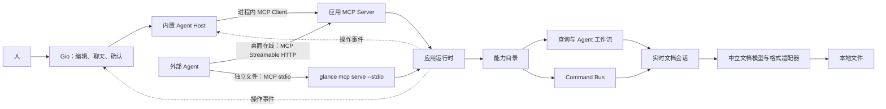

# Glance-Go 的 Agent、MCP 与共享文档运行时

**状态：** 设计稿，待审阅
**日期：** 2026-10-09

## 1. 目标与使用场景

Glance 的主要操作者是 Agent；人提出目标、作出决定并审阅结果。Gio 桌面界面提供文档编辑、内置聊天和人工确认。Agent 能力必须严格大于 Ribbon：每个 Ribbon 操作都可由 Agent 调用，Agent 还可以调用没有单个按钮对应的查询、分析和复合工作流。

当前只实现 MCP 作为 Agent 工具协议。应用核心不依赖 MCP、Gio 或某个模型厂商，使后续入口有可复用的应用能力边界；当前不实现 WebSocket、mDNS、局域网协作或通用插件平台。

设计覆盖两种实际工作方式：

1. **Glance 内置 Agent：** 人打开 Glance，配置模型服务和 API Key，在聊天界面提出目标。模型通过 MCP 工具查询和修改当前文档，例如整理工资数据、起草日报或周报，并生成文档供人审阅。
2. **外部 Codex 等 Agent：** Agent 已在外部整理好数据，通过 MCP 请求 Glance 创建并保存 Word 文档。若目标是新文件，可由无窗口运行时完成；若要使用桌面中的未保存会话，或希望新文档进入已打开的标签页，则连接正在运行的桌面运行时。

默认连接规则是：桌面已运行且要共享实时会话时，外部 MCP 客户端连接桌面提供的 HTTP MCP 端点；要处理独立文件时，通过 stdio 启动无窗口运行时。两个运行时不会伪称共享未保存状态。

## 2. 概念与边界

- **应用运行时**：无 Gio 依赖的应用核心，负责工作区、实时文档会话、查询、命令和能力目录。
- **能力目录**：Agent 可调用能力的静态注册表。每项能力有稳定 ID、操作说明、输入/输出结构、支持格式、风险和执行处理器。
- **Command Bus**：修改命令的进程内分发器，统一检查目标文档、版本、能力、调用身份和幂等性。它不是网络消息队列。
- **MCP 适配器**：把能力目录映射为 MCP 工具。它不直接碰 Gio widget、格式库或工作区恢复快照。
- **Agent Host**：内置聊天的模型调用与工具循环。它通过进程内 MCP Client 调用 Glance MCP 工具，不直接操作文档会话。
- **文档会话**：打开文档后的实时状态，包括中立模型、格式适配器、修订版本和脏状态。SQLite 恢复快照不等于实时会话。
- **应用事件**：操作成功或失败后由运行时发布的结构化通知。订阅方通过 `On` 订阅，收到后更新 UI、聊天状态或其他观察者。
- **外部输入与事件通知**：按钮、内置 Agent 和外部 MCP 请求通过应用能力发起操作；它们不能任意伪造“文档已修改”事件。修改成功后运行时发布事件，订阅方统一接收。
- **视图上下文**：Gio 可向 Agent 提供明确、可序列化的上下文，例如活动窗口、文档、所选单元格或段落 ID。它只是默认目标的辅助信息；命令仍须携带明确目标。不得保存或传递每帧临时的 `layout.Context`。

## 3. 架构

### 3.1 运行时、桌面与 MCP 连接

`application.Runtime` 是工作区和实时文档会话的唯一所有者。桌面启动时创建一个 Runtime，Gio 界面和内置 Agent 都连接它。桌面同时在回环地址提供 MCP Streamable HTTP 服务，要求本地访问凭据，且不得监听局域网接口。外部 Agent 连接桌面端点时使用桌面持有的实时会话。`glance mcp serve --stdio` 始终创建独立的无窗口 Runtime，用于显式路径上的独立文件任务。两种连接都调用同一份能力目录和应用处理器，但只有桌面端点能看到桌面未保存状态。

这样，桌面打开并且 Codex 连接桌面端点时，外部 Agent 和 GUI 看到同一份未保存状态；桌面未打开时，Codex 仍可通过 stdio 创建、编辑和保存独立文件。通过桌面运行时创建或打开的文档会产生应用事件，Gio 可将其显示为标签页。无窗口运行时不会制造虚拟窗口状态。

### 3.2 Agent 能力、目录与命令

能力目录至少覆盖四类能力：

1. **工作区操作**：列出、打开、新建、保存、另存和关闭文档。
2. **查询**：按中立 DTO 读取文档内容、结构、状态、版本和诊断，返回有大小或范围上限的结果。
3. **命令**：修改文档或应用状态。每个 Ribbon 操作映射到一项 Agent 可调用能力，带明确目标和参数。
4. **Agent 工作流**：Ribbon 没有单按钮对应的高层能力，例如工作簿异常检查、跨文档比较、修改计划校验/预览和批量应用。

每项注册都包含稳定 ID、面向 Agent 的操作说明（用途、调用时机、目标、限制）、输入与输出 JSON Schema、适用格式、风险/确认属性和应用处理器。MCP 工具名、描述和 Schema 从注册表生成。目录不得只由 Ribbon 反向生成；Agent 工作流使其能力范围严格大于 Ribbon。

查询走 UI 无关的查询服务；所有修改通过 Command Bus。命令请求带请求 ID、调用方、明确文档 ID、命令 ID、预期版本和结构化参数。必要时使用幂等键。版本冲突、格式不支持、只读、确认待处理和执行失败均返回稳定的结构化结果。

### 3.3 内置聊天和模型配置

新增 `internal/agent`（或等价的独立包）承载 Agent Host、对话状态和模型适配器；它与 `application.Runtime` 分层。第一阶段提供可配置的 OpenAI-compatible 服务地址、模型名和 API Key，服务地址与模型名放普通配置，API Key 放操作系统凭据库。提供 `ModelProvider` 接口，后续模型厂商适配不进入应用运行时或文档格式包。

内置 Agent Host 使用 MCP Go SDK 的进程内 Client/Server 传输调用与外部 MCP 相同的工具清单。模型产生工具调用后，Agent Host 调用 MCP 工具、把结构化结果交给模型继续推理，再把最终答复和文档变更摘要显示在聊天界面。工具业务逻辑只有一份，不能由聊天面板直接调用格式适配器。

聊天界面支持发送、停止、分步显示、工具调用状态和失败信息。需要人确认的操作通过 Gio 确认界面完成；模型不能自我确认。设置界面不记录或展示完整 API Key。界面说明发送到已配置模型服务的内容范围。

### 3.4 事件、订阅与视图状态

命令输入与事件通知使用不同接口。应用入口调用已注册的查询、命令或工作流；运行时只在操作结果确定后发布有类型的事件，例如 `document.changed`、`document.saved`、`document.opened` 或 `operation.failed`。事件包含事件 ID、类型、文档 ID、操作者、命令/请求 ID、修订版本和结构化数据。

应用内 `On` 提供带取消句柄的订阅。Gio 在自己的事件循环中消费通知、更新视图并请求重绘；Agent Host 可消费工具执行状态。事件来源可为 human、built-in-agent 或 external-agent，但来源字段用于审计和策略判断，不改变事件语义。任何调用方都不能通过通用 `Emit` 伪造成功的文档变更通知。

当 Agent 请求使用“当前所选区域”时，Gio 将所选对象 ID、文档版本和可选窗口 ID 作为普通数据注入 Agent 的上下文。若没有附着的界面，调用必须提供目标或返回明确的缺少目标错误。切换标签、定位单元格等纯视图动作使用显式 `ViewIntent`；无窗口模式返回 `no_attached_view`，文档操作本身仍可继续。

### 3.5 安全与文档保护

人决定是否执行高影响操作。待确认请求绑定一次性 ID、目标、影响摘要和文档版本；Agent 自己提交 `confirmed: true` 不构成授权。若 MCP 客户端不支持把人的确认安全传回应用，操作保持待确认且不执行。

保存到新路径与覆盖现有文件是不同操作。覆盖和删除等高影响行为按策略请求确认。格式适配器继续负责原子保存、脏状态保留和兼容性边界；未通过保存/重开验证的格式不得开放覆盖能力。解析、导出和保存在 Gio 帧布局之外完成。

## 4. 代码边界建议

- `internal/application`：Runtime、工作区、实时会话、查询、能力目录、Command Bus、应用事件和 Agent 工作流；不依赖 Gio、MCP 协议或模型 SDK。
- `internal/mcpserver`：将能力目录转换为 MCP Server；提供桌面 Streamable HTTP 服务和无窗口 stdio Server。
- `internal/agent`：模型 Provider、Agent Host、对话/工具调用循环和 MCP Client；不持有文档模型或格式适配器。
- `internal/agentsettings`（或同职责包）：非机密模型设置与操作系统凭据库接口。
- `internal/desktopui`：Gio 窗口、编辑控件、聊天控件、视图状态、人工确认和事件消费。
- `internal/document` 与 `internal/format/*`：中立 DTO、格式解析/编辑/保存；第三方 Office 类型继续封装在格式层。
- `internal/workspace`：恢复快照、标签顺序和本地持久数据；它不作为活动文档会话的共享协议。

迁移采用增量方式。优先提取运行时与会话所有权，再接入查询和命令；不一次性搬迁所有 `desktopui` 文件。

## 5. 实施顺序与完成标准

实施拆成两个互相依赖、可分别验收的计划：

1. **共享运行时与 MCP 能力**：提取应用 Runtime，建立能力目录、查询、Command Bus 和事件；接通桌面 MCP 与无窗口 MCP；再分格式覆盖全部 Ribbon 操作和 Agent 高层工作流。
2. **内置 Agent 聊天**：建立模型配置和凭据存储；用进程内 MCP Client 调用相同工具；加入 Gio 聊天、工具状态和人工确认。

完整目标需满足：

- 每个 Ribbon 操作有可通过 MCP 调用的等价能力，参数可由 Agent 明确提供，不要求打开对话框或模拟点击。
- Agent 还能使用 Ribbon 没有单按钮对应的查询与高层工作流。
- 桌面 MCP、内置 Agent 与 Gio 界面操作共享同一 Runtime 和实时会话。
- 桌面未运行时，stdio MCP 可无窗口创建、修改和保存独立文件。
- 保存为新 Word 文件可以无窗口完成；共享未保存桌面内容或让生成文件进入桌面标签页时连接桌面运行时。
- 每个 MCP 工具有稳定 ID、清晰说明、Schema 和结构化结果；调用失败、版本冲突和确认要求可区分。
- 人工确认、安全保存和格式兼容性要求继续有效。

## 6. 当前仓库依据

- [架构说明](../../architecture.md) 定义 Gio、会话、中立模型、格式适配器和本地文件分层。
- [实时文档会话](../../../internal/desktopui/document_session.go) 当前同时持有格式适配器、修订/草稿协调和窗口视图状态，需要拆分所有权。
- [工作区集合](../../../internal/workspace/collection.go) 管理 SQLite 恢复快照和标签状态，不是实时会话总线。
- [Word Ribbon 分发](../../../internal/desktopui/word_toolbar_dispatch.go) 使用 action ID，可用于建立完整能力清单，但目前仍调用 UI 方法。
- 当前仓库尚无内置模型聊天、模型 API Key 管理或模型 Provider 实现。

## 7. 关键技术依据

- 官方 [MCP Go SDK 传输与生命周期文档](https://github.com/modelcontextprotocol/go-sdk/blob/main/docs/protocol.md) 展示进程内双向传输、stdio 和 Streamable HTTP，可供内置 Agent、桌面服务和外部客户端复用 MCP 工具定义。
- [Codex MCP 文档](https://developers.openai.com/learn/docs-mcp) 展示用 URL 配置 HTTP MCP 服务；桌面端点可供本机 Codex 连接。
- 桌面 MCP 端点绑定回环地址并启用本地凭据校验；端点信息和访问凭据由当前用户安全保存，并提供可复制的 MCP 连接配置。无窗口 stdio MCP 不需要桌面端点。
- 模型 API Key 只经系统凭据库读写，不写入 SQLite、普通配置、日志或聊天记录。
