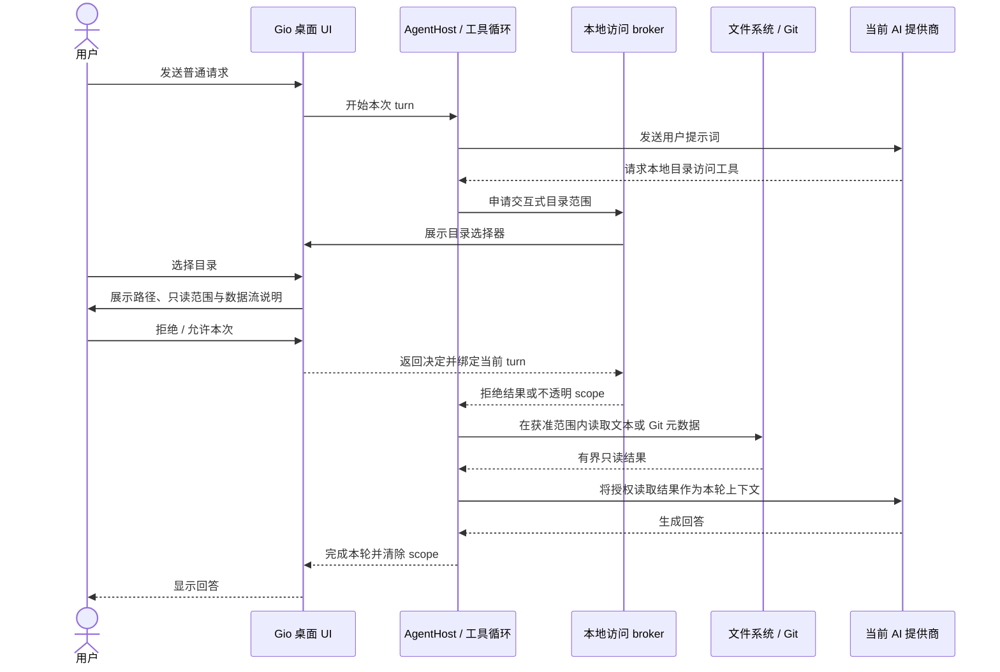

# AI 按需读取本地目录设计

## 状态

待用户审阅。本文根据 Pen 设计节点 `yInjn` 和本次对话确认的授权规则整理；实现前请先审阅本文。

## 背景与问题

当前全局 AI 助手不能按需读取用户电脑上的目录。附件入口目前没有完成实际文件读取流程。用户想直接提出“总结本月工作”之类的请求，再由 AI 判断是否需要访问某个项目目录，读取该目录中的 Git 提交记录或相关文本文件。

本设计将本地目录访问做成一个由 AI 工具调用触发、由用户明确授权、范围受限于所选目录和当前请求的只读流程。用户先正常发送提示词；在授权之前，应用不自动读取或附加本地目录内容。

## 目标

- AI 需要本地资料时才请求访问；用户无需在每次对话前手动准备附件。
- 用户通过系统目录选择器选择真实目录，并能在授权对话框看到确切目录。
- 只提供“拒绝”和“允许本次”两个操作，不提供“始终允许”或权限管理页。
- 一次授权覆盖当前用户请求内所选目录中的后续只读操作；访问另一个目录时重新请求授权。
- 首版能读取受限的 UTF-8 文本文件和 Git 提交元数据，支持“总结本月工作”场景。
- 授权只存在于内存中，并随当前请求结束、取消或应用退出而清除。
- 文件读取和 Git 查询运行在后台；Gio 窗口循环只负责展示、选择和发布结果。

## 非目标

- 持久授权、跨请求复用、权限管理页面或“始终允许”。
- 写入、编辑、移动、删除、执行任意 shell 命令或打开任意 URL。
- 首版读取二进制文件、图片、Office/PDF 文档全文，或 Git diff/patch 内容。
- 让外部或无桌面 UI 的 MCP 客户端绕过交互式授权。
- 更改现有已打开文档的 AI 能力与其既有确认规则。

## 用户流程

1. 用户在全局 AI 对话中发送普通请求，例如“总结本月工作”。提示词可以包含用户自己输入的路径或项目名，但应用不会仅凭提示词在授权前读取该路径。
2. Agent 判断需要本地上下文，调用目录访问请求工具。工具不能接受模型指定的任意绝对路径；它向桌面应用提交一个带有当前请求关联信息的待处理访问请求。
3. 应用打开原生目录选择器，标题说明用户正在选择允许 AI 读取的目录。用户取消选择时，本次访问以取消结果返回，AI 不获得任何目录内容。
4. 用户选择目录后，应用显示居中的授权对话框，参照 Pen 节点 `yInjn` 的层级和信息布局。对话框展示所选目录名称和完整路径、只读范围、用途说明，以及内容会发送给当前 AI 提供商并进入本次对话记录的说明。
5. 对话框只显示两个显式操作：**拒绝**、**允许本次**。Escape、点击遮罩或关闭窗口按“拒绝”处理；不增加第三个按钮或独立管理页面。
6. 用户拒绝时，当前工具调用返回明确的拒绝结果；Agent 可以在没有该目录内容的情况下继续回答。当前请求内再次请求同一个被拒目录时直接返回拒绝，避免反复弹窗。用户取消原生选择器时同一请求不自动再次打开选择器。
7. 用户允许时，应用为当前请求建立内存中的目录授权范围。Agent 可在该范围中列目录、读取符合限制的文本文件，并查询所选仓库的提交元数据；每次访问仍由应用校验范围和路径。
8. 同一请求访问同一目录不再重复弹窗。需要访问另一个目录时，重新显示目录选择器和授权对话框。每个目录分别授权。
9. 请求完成、失败、用户停止生成、切换/关闭会话，或应用退出时，清除该请求的所有目录范围及其缓存。后续新请求必须重新选择并授权。

## 授权语义

- **授权单位：** 当前全局 AI 助手的一次用户请求（turn），而非整个会话、工作区或应用生命周期。
- **授权主体：** 当前桌面 AI 请求的可信内部标识，包括会话、turn 和窗口/请求关联信息。标识由控制器注入，不接受模型通过工具参数伪造。
- **授权对象：** 用户通过原生选择器选定并由应用解析后的一个目录根。授权包括该根目录内的允许操作；另一个目录根必须单独授权。
- **授权时长：** 仅在当前 turn 活跃期间。取消、失败、完成、离页中断和应用退出都撤销授权。若会话恢复或重试为新的 turn，不继承旧授权。
- **操作范围：** 只读目录列表、受限文本读取和受限 Git 提交元数据查询。授权不等于同意执行命令、写文件或读取不在根目录内的内容。
- **重复请求：** 获准目录在本 turn 内复用；被拒或取消的目录请求在本 turn 内不重复弹窗。新 turn 重置授权与拒绝记录。

## 首版可用能力

提供窄范围、结构化的本地工具，不提供通用文件系统 API 或 shell：

| 工具 | 输入 | 行为与边界 |
| --- | --- | --- |
| `local.request_directory_access` | 简短用途说明 | 打开系统目录选择器；模型不能传入或覆盖所选绝对路径。用户完成选择和授权后，返回不透明的 `scope_id`、目录显示名及操作能力。 |
| `local.list_directory` | `scope_id`、相对路径 | 只列出授权根内的直接子项；单次最多返回 500 项，跳过 `.git` 和明显的凭据/密钥文件。需要递归时由 Agent 逐层请求。 |
| `local.read_text_file` | `scope_id`、相对路径 | 只读 UTF-8 文本；单文件最多 1 MiB。拒绝二进制、超大文件、特殊文件、凭据/密钥文件和越界路径。 |
| `local.list_git_commits` | `scope_id`、开始/结束时间、条数上限 | 仅对授权根本身是 Git 工作树根目录的情况返回提交元数据。每次最多 200 条；包含短提交 ID、提交日期、作者显示名、标题和相对变更路径，不包含 diff、patch、作者邮箱或提交正文。 |

实际工具名可在实现时与现有 capability 命名规范协调，以上语义和权限边界保持不变。

### 文件系统边界

- 所有路径参数必须是规范化的相对路径；拒绝绝对路径、`..`、空绕过路径、NUL 字节和平台分隔符变体。
- 打开文件前解析并验证真实路径仍位于已授权根内。子项符号链接若指向授权根外，一律拒绝；不跟随目录遍历中的外部链接。
- 仅处理普通文件和目录。拒绝设备、FIFO、socket 等特殊文件。
- 隐藏目录中的 `.git` 内容不通过通用列目录或文本读取工具开放。Git 元数据只通过固定、只读的 Git 查询获得。
- 目录列表、文本大小、提交条数、进程时限和最终工具结果大小均有硬上限。工具输出仍受 AgentHost 现有工具结果上限约束；超限时返回可解释错误，不截断后伪装成完整数据。
- 凭据/密钥文件使用路径名规则和常见格式特征进行拒绝。该规则是减小意外读取的保护措施，不承诺能识别所有敏感信息；所选目录中的其他获准文本在用户批准后可被发送给当前 AI 提供商。

### Git 查询

- 使用参数数组调用固定的 `git` 可执行文件，不经过 shell，不接受模型提供的命令、选项或可执行路径。
- 验证 `git rev-parse --show-toplevel` 的工作树根与授权目录的规范路径相同；选择仓库子目录时，不读取更上层仓库的历史。Git worktree 可以使用其工作树根进行查询，输出仍仅限提交元数据。
- 使用固定格式和日期过滤进行 `git log` 查询；设置禁用 pager、交互提示和可选写锁的环境选项，设置明确超时。不得调用 diff、外部 diff 驱动、钩子或任意 Git 子命令。
- 时间范围使用明确的 ISO 日期/时间边界，校验开始不晚于结束；默认时间范围由 Agent 根据用户请求指定。上限之外的结果通过 `has_more` / `truncated` 元数据说明，禁止静默宣称覆盖全部历史。
- Git 失败、目录不是仓库、仓库根不匹配或超时都返回结构化错误，不回退到任意 shell 命令。

## 架构与交互

沿用仓库现有边界：Gio UI → session/controller → neutral application runtime / capability → 本地文件系统与 Git。格式库不参与本功能。

1. AgentHost 在后台执行模型工具循环。目录访问 capability 通过应用注入的本地访问 broker 发出请求，并异步等待该请求的决定；等待不占用 Gio 帧循环。
2. broker 将带有可信会话/turn 标识的请求发给桌面控制器。控制器负责原生选择器和授权对话框，并将“允许、拒绝、取消、窗口销毁、请求过期”之一交回 broker。
3. broker 在获准后创建只读 scope，并在每次文件/Git 工具调用前校验 scope 属于当前 turn、仍有效且请求中的相对路径在目录范围内。
4. 本地文件读取和 Git 子进程运行在受管理的后台任务中。结果通过同步状态/通道回到 AgentHost；用户停止生成或请求失效时取消等待和子进程。
5. scope 不持久化到 workspace 偏好、数据库、日志、崩溃报告或模型可控的全局状态。scope ID 使用不可预测的不透明值，并与可信 turn 绑定。
6. 没有活跃桌面控制器的执行环境（例如外部/headless MCP）返回 `interactive_authorization_unavailable`，不以任何默认许可继续。

## 授权对话框内容

基于 Pen 节点 `yInjn` 的居中确认面板，收敛为本次确认的两按钮规则：

- 标题表达正在请求 AI 读取所选文件夹。
- 展示目录名称和完整路径，避免用户只看到模糊的项目名。
- 清楚说明只读能力：列出目录、读取受限文本、查看 Git 提交元数据；不会修改文件。
- 展示用户本轮原始请求摘要作为用途上下文；模型提供的用途文字可辅助说明，但不能替代所选路径和权限范围。
- 明确说明读取的内容将发送给当前 AI 提供商并保存进本地对话记录。若当前实现对特定提供商的传输/记录行为不同，UI 文案须由实际行为驱动，不能作不准确保证。
- 两个按钮分别是“拒绝”和“允许本次”。不显示“始终允许”、权限管理入口或会产生持久许可的选项。
- 拒绝、Escape、遮罩关闭及窗口关闭均撤销这一次待处理申请；没有默认选中“允许”。

## 取消、错误与恢复

- 选择器取消、用户拒绝、scope 过期、越界/符号链接、不可读文件、非 UTF-8/二进制、超限、非仓库、Git 超时和无 UI 授权环境均返回不同的稳定错误码及简短可读说明。
- 用户拒绝后，Agent 收到拒绝状态，可继续回答或说明缺少资料；不得把拒绝转换为重试或回退到其他读取渠道。
- 用户取消选择器后，同一 turn 内重复的相同访问请求不再弹出，避免自动循环；用户发起下一条新消息后可重新尝试。
- 用户停止生成、离开对话或窗口被销毁时，待处理请求立即取消；迟到的选择器/文件读取结果不得绑定到新的 turn。
- 后台读取完成后，在写入对话工具结果前再次验证 turn 仍有效。

## 对话数据与隐私

- 授权前，本地目录内容不进入模型提示词、Agent 消息、工具结果或诊断日志。
- 授权后，获准读取的文本/Git 元数据会进入模型工具结果并发送给当前 AI 提供商，也会按现有对话持久化机制保存在该对话记录中。授权 UI 必须提前说明这两种数据流。
- 绝对路径只用于本地 picker、授权展示和本地范围校验。工具结果及给模型的上下文优先使用目录显示名、相对路径和不透明 scope ID；除非用户原始提示词本身包含路径，不额外向模型返回授权根绝对路径。
- 不在普通日志或错误遥测中记录文件正文、Git 提交正文、密钥内容或绝对路径。错误中涉及文件时优先使用相对路径。
- 用户删除对话按现有产品机制处理其已持久化工具内容；撤销 turn scope 不等同于擦除已生成并保存的对话历史。

## 验收标准

- 用户可先发送普通 AI 请求；未授权时，不会读取或附加任何所选目录内容。
- Agent 请求访问时显示原生目录选择器；取消选择器不会创建 scope。
- 选择目录后，授权面板准确显示目录路径和只读数据流，且仅提供“拒绝”和“允许本次”。
- 拒绝、遮罩关闭、Escape 和窗口关闭都不会读取目录；被拒请求不在同一 turn 自动重弹。
- 允许后，当前 turn 能列出目录、读取限制内的 UTF-8 文件并查询该授权仓库的提交元数据；文件或 Git 输出可被模型用于回答。
- 同一已授权目录在本 turn 内复用；另一目录再次走选择和确认；新 turn 不继承任何 scope。
- 路径穿越、符号链接出根、非普通文件、二进制/超大文本、非仓库根、Git 超时和工具结果超限都被拒绝且有明确错误。
- 停止生成、切换/关闭会话、完成 turn 和退出应用后，scope 失效；迟到结果不会泄露到后续对话。
- headless / 外部 MCP 调用无法获得交互式 scope。
- UI 线程在选择器、对话框和后台文件/Git 操作期间保持响应。

## 主要风险与待实现注意事项

- 本地文本在用户授权后会发往当前 AI 提供商并留在对话记录中；授权文案必须直接说明，且不能在同意前读取内容。
- 常见敏感文件规则只能降低误读概率，无法替代用户对所选目录及内容传输的判断；授权边界和可见路径是首要保护。
- Git 配置可能来自仓库或用户环境；实现时应固定调用参数与环境、禁止外部 diff 和交互行为，并验证运行不会触发写入。
- AgentHost 的工具调用目前与 UI 通知确认存在异步生命周期差异。新 broker 必须让同一工具调用等待 UI 决定，同时支持取消、超时和过期检查；不能将授权实现为工具调用结束后的独立确认。
- 现有工具结果有大小上限；读取工具必须在产生/序列化大结果前执行上限校验，以免内存或消息膨胀。
- 本设计只覆盖全局 AI 助手及其桌面请求上下文。其他 AI 入口应在各自设计中复用授权 broker，不能绕过它直接访问文件系统。

## 建议验证范围

实现阶段为 broker、路径范围校验、Git 参数构造、turn 清理和拒绝/取消状态增加单元与交互回归；UI 覆盖 1x/2x 实际渲染、两个按钮、路径展示、Esc/遮罩取消及等待期间窗口响应。验证还应确认工具结果限制、headless 拒绝和对话持久化提示与真实行为一致。本节是后续实现验收建议，不表示当前已添加或执行这些检查。
